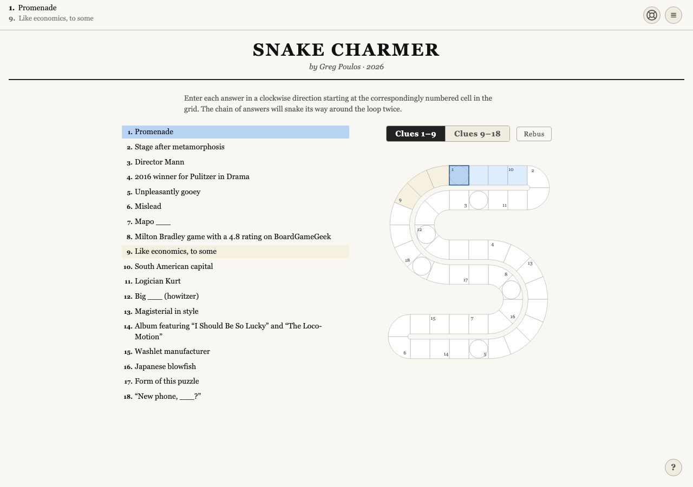
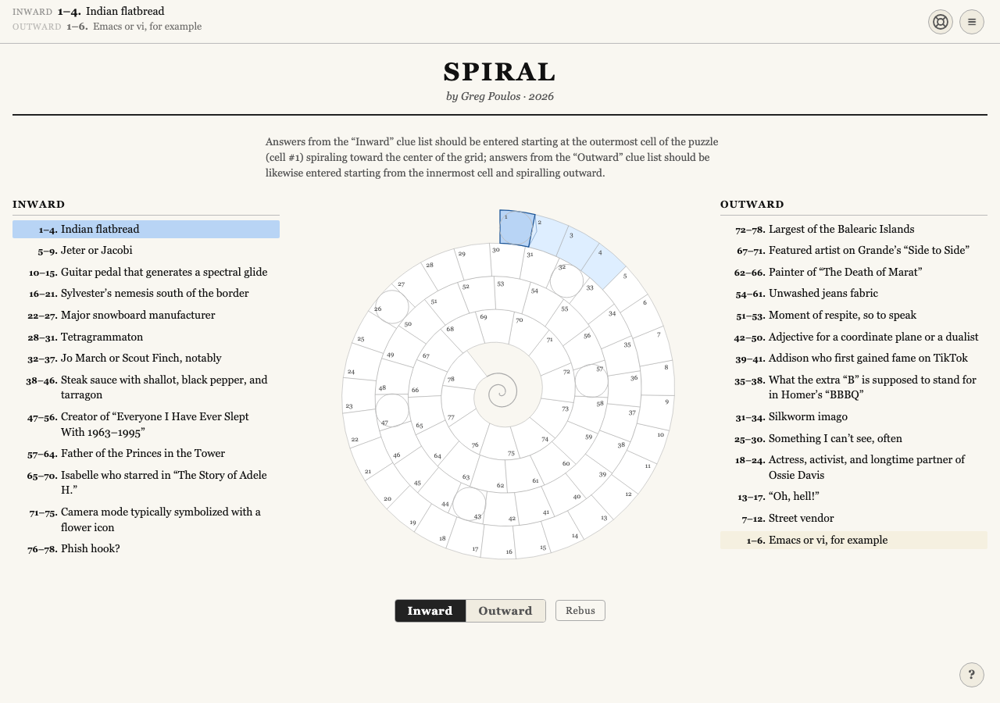
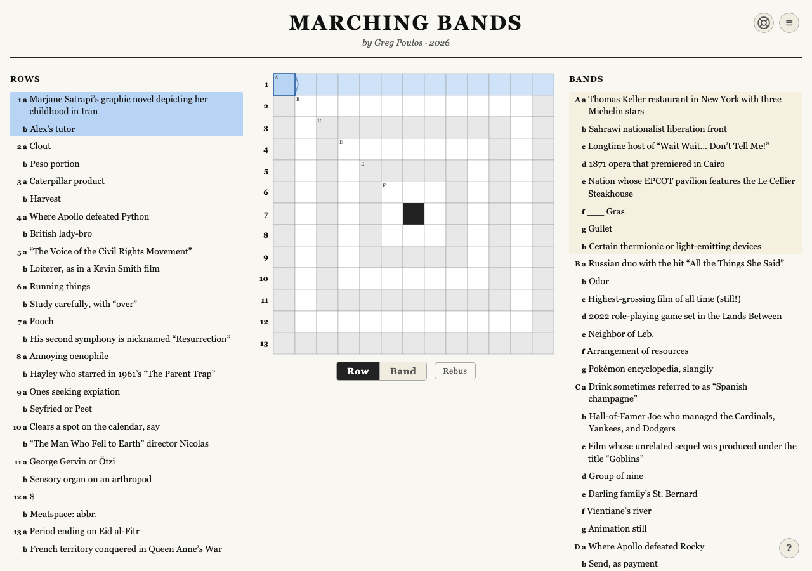
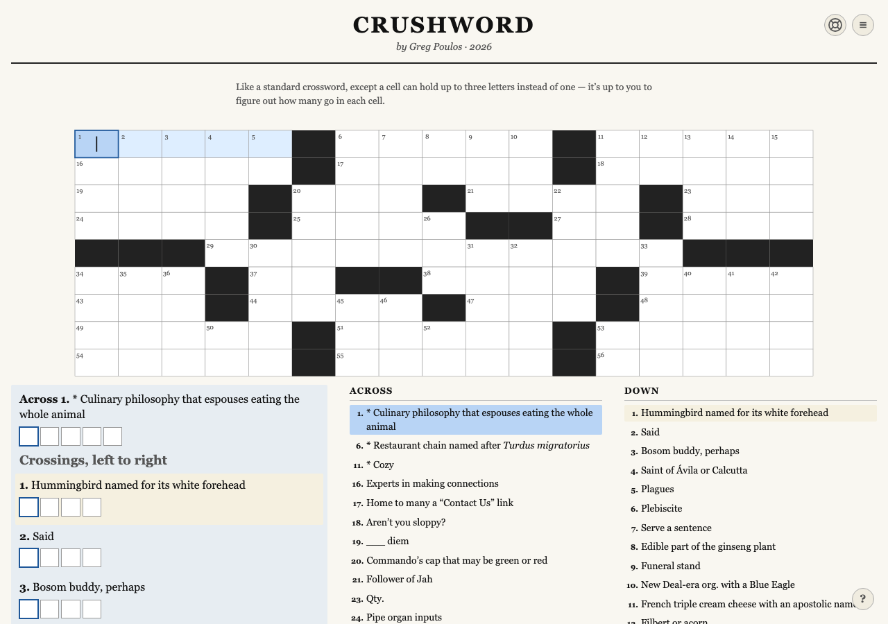

# varietypack

[](https://github.com/gregpoulos/varietypack/actions/workflows/ci.yml)

varietypack turns a YAML puzzle definition into a single self-contained HTML page: playable in a browser, printable, and needing no back end. It makes four kinds of variety word puzzle: Snake Charmer, Spiral, Marching Bands and Crushword.

**[Try the examples online](https://gregpoulos.github.io/varietypack/examples/)** · **[Open the studio](https://gregpoulos.github.io/varietypack/studio/)**

## Requirements and install

Node 22.12 or later.

```fish
git clone https://github.com/gregpoulos/varietypack.git
cd varietypack
npm install
npm link
```

`npm link` symlinks the package into npm's global prefix and puts `varietypack` on your PATH. To skip it, run the same commands as `node cli.js <subcommand>` from the repo root. Everything below uses `varietypack`.

## How it's built

- **Output has no runtime dependencies.** Each puzzle page inlines its script, styles and data; it loads from `file://` or any web server. (The one opt-in exception is `--font link`, which loads a theme's font from a CDN instead of embedding it.) Clues are rendered from markdown at build time, so the page carries no markdown library.
- **One build path, in Node and in the browser.** The command line and the [studio](#studio) both build through `shared/build/`, and a test checks that the two produce identical bytes for every example and fixture. See [docs/ARCHITECTURE.md](docs/ARCHITECTURE.md).
- **Answer-hidden builds are checked against a board hash.** A muddled puzzle ships a SHA-256 of the board instead of its answers, and the page compares the solver's grid to that hash.
- **Two test suites.** Unit tests run on `node:test`; browser tests run in Playwright (Chromium, WebKit and Firefox, plus phone-sized projects). See [Testing](#testing) and [docs/TESTING.md](docs/TESTING.md).

## Usage

```fish
# Build a single puzzle (kind auto-detected from the YAML's `kind` field)
varietypack build puzzle.yaml

# Build all YAML puzzles in a directory (output next to each input)
varietypack build examples/

# Build all YAML puzzles into a specific output directory
varietypack build examples/ -o out/

# Build all YAML puzzles and write an index.html linking them
varietypack build examples/ --build-index

# Watch a directory for changes and rebuild automatically
varietypack watch examples/

# Validate a puzzle file, or every puzzle in a directory, without building
varietypack validate puzzle.yaml

# Produce a muddled YAML (answers obscured) for distribution
varietypack muddle puzzle.yaml
```

The `varietypack` dispatcher reads the `kind` field from each YAML and routes to the correct tool automatically. In directory mode, all YAML files are built; a file that isn't a puzzle of a known `kind` is reported as an error, and the rest still build.

### Muddling puzzles

`varietypack muddle <file.yaml>` produces a **muddled YAML**: the puzzle with its answers replaced by cell counts and a hash of the solved board, for collaborators or test-solvers who build the page themselves without seeing the answers. Building one always produces an answer-hidden page. Details: [docs/AUTHORING.md](docs/AUTHORING.md) → "Muddling and hashed builds".

```fish
# Produce puzzle.muddled.yaml next to the source
varietypack muddle puzzle.yaml

# Write to a specific path
varietypack muddle puzzle.yaml -o dist/puzzle.yaml

# Overwrite an existing muddled file
varietypack muddle puzzle.yaml -f
```

### Global options

These are supported by every tool:

| Option | Default | Description |
|---|---|---|
| `--muddle` | off | Build a hashed (answer-obscured) HTML from a source YAML — no `hashed:` field needed. Muddled YAMLs (which carry `boardHash:`) build hashed automatically without this flag. |
| `--theme <name>` | the YAML's `theme:`, else `broadsheet` | Visual theme; overrides the YAML's `theme:` field. The theme list is shared across all tools (see `docs/AUTHORING.md` → "Themes and fonts"); all tools ship `broadsheet`, `skeleton` and `swiss`. |
| `--font <mode>` | `embed` | Font delivery for custom-font themes: `embed` inlines fonts as base64 (self-contained output) or `link` references a CDN via `@import` (needs network at solve time). Defaults to `embed` (or `link` for a theme with no local font files); ignored for system-font themes. |
| `--embed-origin <origin>` | off | Post the completion message, including the solution, to this one parent origin (e.g. `https://hunt.example.com`) and no other, for embedding. Meaningful with `--muddle`: the host can check the solution against the `boardHash`. |
| `--minify` | off | Minify the generated HTML: each `<script>` and `<style>` through esbuild, and trailing whitespace elsewhere. A script that can't be parsed is left as written, with a note on stderr. |
| `-o`, `--output <file>` | `<input-basename>.html` | Output path. Defaults to writing next to the input file. |
| `-f`, `--force` | off | Overwrite the output file if it already exists. |

### Tool-specific options

Some tools accept additional options. When building a directory, each applies only to the puzzles of that kind, so `--shape` reshapes the Snake Charmers and the other puzzles ignore it; given to a single puzzle of another kind, it's an error.

| Tool | Options |
|---|---|
| `snake-charmer` | `--shape circle\|stadium\|turn\|double-turn` |

---

## Puzzle formats

[docs/AUTHORING.md](docs/AUTHORING.md) has the rules every format shares (header fields, markdown in clues, normalization, cell styles, rebus cells, muddling, themes), and each format's `docs/SPEC.md` its own fields and an example. The [examples](examples/) are complete puzzles of each kind.

### Snake Charmer

N numbered answers fill a continuous snake-shaped loop of cells. Each answer starts at its numbered cell and proceeds clockwise; the loop is closed so the last answer ends where the first begins. **[Try an example](https://gregpoulos.github.io/varietypack/examples/broadsheet/snake-charmer.html)**



See [snake-charmer/docs/SPEC.md](snake-charmer/docs/SPEC.md) for the full format reference.

### Spiral

Two sets of entries share every cell: inward entries fill the spiral from the outer edge toward the center; outward entries fill it from the center back out. The inward cells, read in order, must be the reverse of the outward cells. Minimum 40 cells. **[Try an example](https://gregpoulos.github.io/varietypack/examples/broadsheet/spiral.html)**



See [spiral/docs/SPEC.md](spiral/docs/SPEC.md) for the full format reference.

### Marching Bands

An N×N grid where words march in two formations: **Rows** (two or more words per numbered row, reading left to right) and **Bands** (words march clockwise around each concentric rectangular band). Every cell belongs to exactly one Row word and one Band word; where words begin and end within a row or band is for the solver to discover. For odd N, the center cell is a black square. **[Try an example](https://gregpoulos.github.io/varietypack/examples/broadsheet/marching-bands.html)**



See [marching-bands/docs/SPEC.md](marching-bands/docs/SPEC.md) for the full format reference.

### Crushword

A rebus crossword: standard American crossword grid and clue numbering (across/down, black squares), plus the repo-wide rebus convention that a bracketed group in an `answer:` occupies a single cell however many letters it holds. **[Try an example](https://gregpoulos.github.io/varietypack/examples/broadsheet/crushword.html)**



See [crushword/docs/SPEC.md](crushword/docs/SPEC.md) for the full format reference.

---

## Themes

All tools share one set of themes. A theme controls colors, fonts, and decorative styling — never layout. Select one with the YAML's `theme:` field or `--theme <name>`, which overrides it (default `broadsheet`). The repo ships `broadsheet` (warm newsprint, system serif), `skeleton` (dark, custom display font) and `swiss` (black on white with an orange accent, system sans-serif).

`--font` controls how a custom-font theme's font is delivered (see [Global options](#global-options)). To add a theme, see [docs/ARCHITECTURE.md](docs/ARCHITECTURE.md) → "Themes and print".

---

## Studio

The studio is a browser page for composing puzzles without the command line. Open or create a puzzle of any kind, edit it on a board with live problem checking (or as YAML with the *Edit as YAML* button, which is also where a file the editor can't represent opens), test-solve the built puzzle page, and export it. It runs the same build path as the CLI, in the page, so what it builds is byte-identical to what `varietypack build` writes; nothing is sent anywhere.

Build it and open it in your browser with one command:

```fish
npm install
varietypack studio      # builds studio/build/index.html, then opens it
```

`-o <file>` writes the page elsewhere (`-f` to replace an existing file), and `--no-open` only builds. The page is one self-contained file, so it also opens from disk or hosts anywhere; `npm run build:studio` builds it without opening.

The public repo hosts it, with every example in every theme, on GitHub Pages; `npm run build:site` builds that site locally.

What it does today:

- **A structured editor for every kind**: type letters onto the real board (the spiral, the ring, the grid), split entries where you want them (Crushword: place blocks as you go, with live numbering), and then clue them in the Clues step, a list of their own. New puzzles start from a chosen size, or from a kind's example; opening a source file imports it into the editor, and it exports a file that builds the same page.
- **Test-solving an unfinished puzzle**: a puzzle missing only clues still test-solves, with placeholder text in the empty ones; the Clues step's Fill empty clues writes that text into the puzzle so you can edit it.
- **Live problems list** (the same validators as `varietypack validate`) and a **sandboxed preview** you can test-solve, with the time it took you to solve it shown beside the preview. A theme picker beside the preview restyles it, and Export starts from that theme.
- **Export** offers the puzzle page or the source YAML, each in a theme you choose, with an optional *Answers: Hidden* setting that produces the answers-hidden form of either. A puzzle with errors can't export its page; an unfinished one still saves a draft file you can reopen in the studio.
- **Back and Forward** move between the start screen, your puzzles and their phases, and a reload returns to the open puzzle.
- **Drafts** saved automatically in the browser (answers in plain text); download one from Export to keep a copy or move computers.
- **Build-only mode** for an answers-hidden YAML someone sends you: pick a theme, test-solve it, and build its page without ever seeing the answers.

---

## Embedding puzzles

A puzzle page can sit in an iframe on another site, such as a puzzle hunt, and tell that site when it's solved. Build it from the command line with `--muddle --embed-origin <origin>`.

```html
<iframe src="puzzle.hashed.html" title="My puzzle" data-varietypack style="width:100%;border:0;min-height:480px"></iframe>
<script>
addEventListener('message', function (e) {
  if (!e.data || e.data.type !== 'varietypack:resize') return;
  document.querySelectorAll('iframe[data-varietypack]').forEach(function (f) {
    if (f.contentWindow === e.source) f.style.height = e.data.fill ? '100svh' : e.data.height + 'px';
  });
});
</script>
```

The page posts `varietypack:resize` whenever its height changes, so the frame fits it. On a phone the puzzle fills the screen, so it asks for a frame one screen high (`fill`) instead. When the solver finishes, it posts one `varietypack:complete` message, with the `solution`, to the origin you named and to nobody else. The message also carries `checks` and `reveals`: how many times the solver used Check and Reveal.

To verify a solve on the host's server: check that `e.origin` is the puzzle's origin, then check `sha256hex(solution) === boardHash`, using the `boardHash` from the puzzle's muddled YAML. The server never needs the answers. Only the answers-hidden (`--muddle`) page gives a verifiable solve: a plain page ships its answers, so a posted solution proves nothing. Whether a solver's progress is kept inside a cross-origin iframe depends on the browser, and hasn't been checked. A puzzle can also override theme tokens to match the host site: see [docs/AUTHORING.md](docs/AUTHORING.md) → "Theme overrides".

---

## Testing

`npm test` runs the unit tests and `npm run test:e2e` the browser tests (Playwright). See [docs/TESTING.md](docs/TESTING.md), and [docs/ARCHITECTURE.md](docs/ARCHITECTURE.md) for how the pieces fit together.
